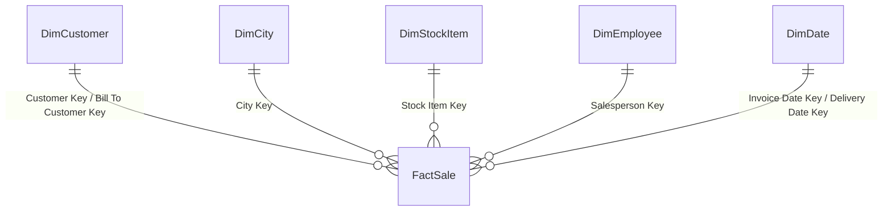

# Sales & Profitability Overview

**Far West region · January 2013 – May 2016**

An end-to-end analysis of a star-schema sales dataset: data profiling, data-quality checks, cleaning, modeling, and a dashboard that answers key questions about products, customers, regions, salespeople, and profitability.

> **TODO:** add a dashboard screenshot here, e.g. ``

---

## Table of contents
1. [Headline numbers](#headline-numbers)
2. [Business questions](#business-questions)
3. [Dataset](#dataset)
4. [Data model](#data-model)
5. [Data quality findings](#data-quality-findings)
6. [Key insights](#key-insights)
7. [Limitations](#limitations)
8. [Repository structure](#repository-structure)
9. [How to use](#how-to-use)
10. [Author](#author)

---

## Headline numbers

| Metric | Value |
|---|---|
| Revenue (excluding tax) | 19.88 M |
| Profit | 9.92 M |
| Profit margin | 49.9% |
| Sales lines | 26,397 |
| Invoices | 8,188 |
| Products sold | 227 |
| Delivery cities | 75 (6 states) |
| Identified customers | 48 (+ "Unknown" customer) |
| Salespeople | 10 |

> The currency symbol was lost in the source export (it appears as `?`), so monetary values are shown without a currency.

---

## Business questions

The analysis is organised around these questions:

1. Which products generate the most profit, and which lose money?
2. How do sales and profit change over time (seasonality and growth)?
3. Which states and cities perform best?
4. How concentrated is revenue among customers, and who is the "Unknown" customer group?
5. How do salespeople compare on revenue, profit and margin?
6. What does a typical order look like (lines per invoice, order value)?
7. Which sizes and colours of product variants sell best?
8. How regularly do customers place orders?
9. **Which transactions or products contribute most to losses or unusually low profit?**

---

## Dataset

Six files forming a star schema (one fact table and five dimensions):

| File | Type | Rows | Description |
|---|---|---|---|
| `FactSale.csv` | Fact | 26,397 | One row per invoice line: quantity, price, tax, profit, keys |
| `DimCity.csv` | Dimension | 13,028 (3,594 unique cities) | City, state, population, geographic location |
| `DimCustomer.csv` | Dimension | 402 | Customer, bill-to customer, buying group, credit limit |
| `DimStockItem.csv` | Dimension | 672 (228 unique items) | Product name, colour, size, package, lead time, list price |
| `DimDate.csv` | Dimension | 1,460 | Calendar and fiscal attributes (fiscal year starts in November) |
| `DimEmployee.xlsx` | Dimension | 212 (20 unique people) | Employees and salesperson flag |

**Coverage:** all sales are delivered to the Far West states (CA, WA, OR, AK, NV, HI), from 2013-01-01 to 2016-05-31.

---

## Data model



- `FactSale[Customer Key]` and `[Bill To Customer Key]` both relate to `DimCustomer[Customer Key]`.
- `FactSale[Salesperson Key]` relates to `DimEmployee[Employee Key]`.
- `FactSale[Invoice Date Key]` and `[Delivery Date Key]` relate to `DimDate[Date]`. Both are `M/D/YYYY` text in the source.
- Referential integrity is perfect: there are no orphan keys in any relationship.

---

## Data quality findings

A column-by-column check covered missing values, formats and types, and outliers.

| Issue | Where | Recommended handling |
|---|---|---|
| Tax Rate is an exact copy of Lead Time Days (672/672 rows) | `DimStockItem` | Exclude; use `FactSale[Tax Rate]` |
| Dimension tables keep history (several rows per entity) | `DimCity`, `DimStockItem`, `DimEmployee` | Group by name or WWI ID, not by surrogate key; use City + State as the city identity |
| `Valid From` / `Valid To` truncated or `#####` / `#VALUE!` | `DimCustomer`, `DimStockItem`, `DimEmployee` | Do not rely on them |
| Currency symbol replaced by `?` | `Credit Limit`, `Recommended Retail Price` | Strip the prefix and convert to numbers |
| Date keys stored as `M/D/YYYY` text | `FactSale` | Convert to a date type |
| Barcode in scientific notation (digits lost); 97.6% `N/A` | `DimStockItem` | Drop |
| Empty or constant columns | `Photo`, `Discount`, `Lineage Key`, `Country`, `Sales Territory`, `Category` | Drop |
| Placeholder text (`N/A`, `NULL`, `Unknown`) | Various | Treat as missing |
| Double spaces in product descriptions (800 rows) | `FactSale[Description]` | Normalise whitespace before text joins |
| Customer postal codes all fall in 90005–90800 despite customers in many states | `DimCustomer` | Use `City Key` for location, not postal code |
| Population = 0 for 28.7% of city rows | `DimCity` | Treat as unknown, not zero |
| 34.4% of sales lines have `Customer Key` = 0 ("Unknown") | `FactSale` | Keep and label as "Unknown customer" |

Internal consistency of the fact table is strong: `Total Excluding Tax = Quantity × Unit Price`, `Tax Amount`, and `Total Including Tax` reconcile on every row, and `DimDate` passes all calendar and fiscal-year checks.

---

## Key insights

- **Losses are small but concentrated.** 566 sales lines (2.1%) lose money, totalling −40,502, which is 0.41% of total profit. Two causes explain all of it:
  - **Halloween zombie mask (Light Brown):** priced at 18 against a unit cost of 19, so every one of its 492 sales loses 1 per unit (−33,060, or 81.6% of all losses).
  - **USB items sold below list price in 2016:** 74 lines across 14 products were sold at 10% of list price (Jan–Mar) and 15% (Apr–May), for −7,442. The same items sold at list price in 2013–2015.
- **Unusually low (but positive) margin** comes from two products only: Superhero action jacket (Blue), 26.7% margin across 11 sizes, and Halloween skull mask (Gray), 16.7%. The overall median margin is about 56%.
- **Profit is concentrated in few products.** The top 20% of products generate about 68% of positive profit.
- **Revenue is evenly spread across identified customers.** The top 5 account for 13% and the top 10 for 25% of known revenue. However, 34% of revenue comes from sales with no customer attached.
- **Salespeople perform very similarly:** revenue ranges from 1.79 M to 2.22 M, with margins of 49–51%.
- **Price and cost are fixed per product.** Losses and low margins are therefore product-pricing issues, not driven by customer, salesperson, region or order size.
- **Volume is growing:** sales lines rose from 7,136 (2013) to 7,720 (2014) to 8,281 (2015). There are no Sunday sales, and Saturday volume is about half a weekday.

---

## Limitations

- **Region only:** the data covers six Far West states, so findings do not generalise to the whole US.
- **Period:** sales end on 2016-05-31, so there are 3 full calendar years (2013–2015) and 2 full fiscal years (FY2014–FY2015).
- **Unidentified customers:** 34% of sales cannot be attributed to a customer.
- **Pricing events:** the 2016 below-list USB sales may be a promotion or a pricing error. The data cannot tell which.
- **Product hierarchy:** there is no product category column, so variants (size, colour) must be parsed from product names.
- **No inventory, discount or supplier data,** so stock-out risk and volume-discount analysis are out of scope.

---

## Repository structure

*Suggested layout; adjust to your project.*

```
.
├── README.md
├── data/
│   ├── raw/            # the six original source files
│   └── cleaned/        # cleaned tables used by the dashboard
├── dashboard/          # dashboard file (e.g. .pbix / .xlsx) or notebooks
└── docs/
    ├── data_quality_report.md
    └── images/         # dashboard screenshots
```

---

## How to use

1. Clone this repository.
2. Load the six files from `data/raw/` into your BI/analysis tool: **[TODO: Power BI / Excel / Python / other]**.
3. Apply the cleaning steps listed in [Data quality findings](#data-quality-findings).
4. Create the relationships shown in [Data model](#data-model).
5. Open the dashboard in `dashboard/` or rebuild it using the questions above.

---

## Author

**[Your name]** · [LinkedIn](https://www.linkedin.com/) · [Email](mailto:you@example.com)

> **TODO:** add a license (for example MIT) and credit the original data source if it has one.
